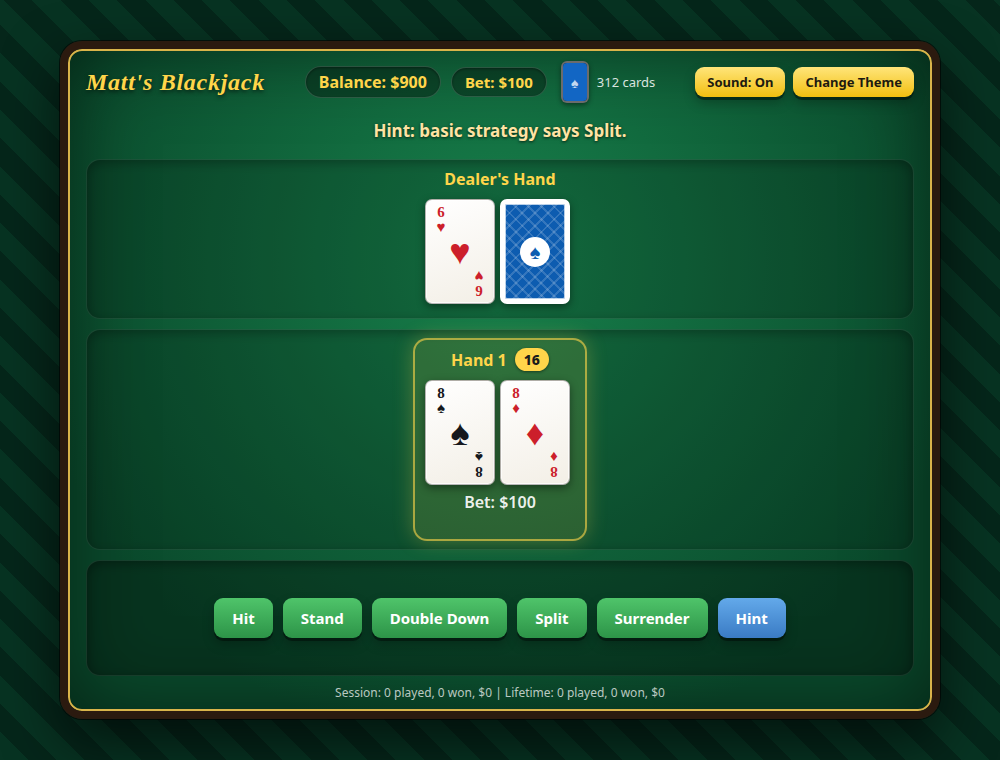
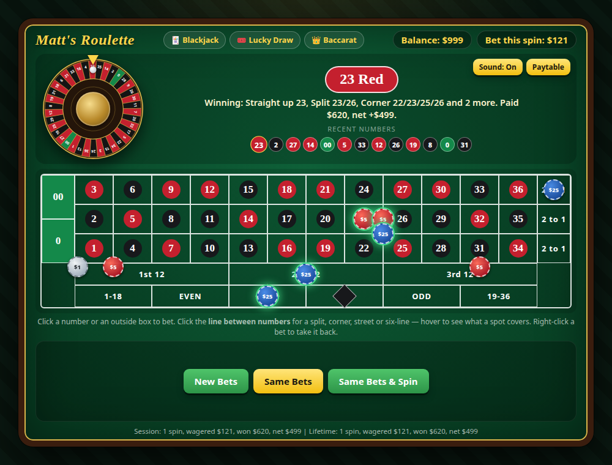
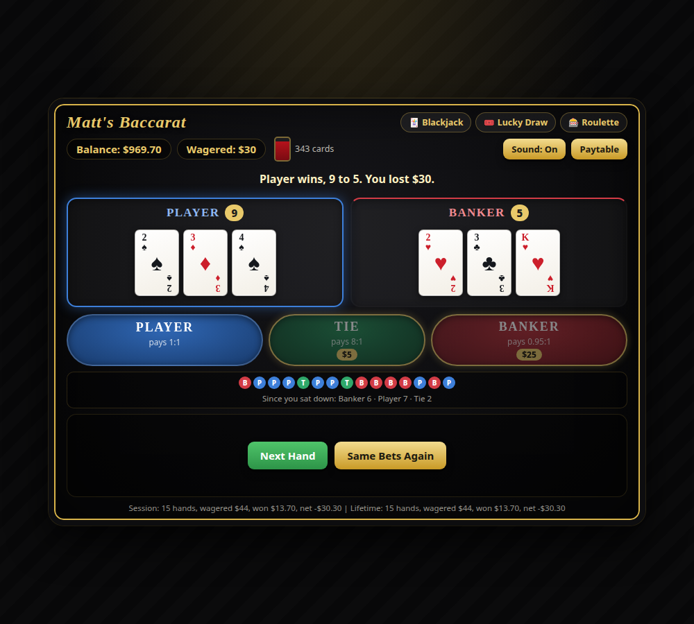

# Advanced Blackjack Game

## ▶️ [Play Now](https://mattgrilli.github.io/blackjack.html)

No download or install needed. Just click the link above and play in your browser.

## Overview

This is an implementation of the classic casino game Blackjack, built with HTML, CSS, and JavaScript. The game features a sleek user interface, realistic chip betting, and adherence to standard Blackjack rules.




## Features

- Realistic chip betting system with multiple denominations
- Type an exact bet amount, or hit **Rebet** to repeat your last wager
- Multi-hand support with splitting functionality
- Double down, surrender, and insurance
- Six-deck shoe with a randomly placed cut card
- Dealer AI that follows standard casino rules
- Animations for card dealing and chip movement
- A felt table with three color themes, and a layout that fits on one screen from phones to desktops
- Session and lifetime statistics tracking
- Hot and cold streak notifications
- **Hint** button that suggests the basic-strategy play (and advises declining insurance). Switch hints off with the **Hints** toggle and the button disappears; the setting is remembered
- Sound effects with a mute button (your choice is remembered)
- Keyboard-friendly: chips are focusable buttons, cards are labeled for screen readers, and results are announced
- Keyboard shortcuts: H (hit), S (stand), D (double), P (split), R (surrender), Enter (deal)

## Running Locally

To play online, use the [Play Now](https://mattgrilli.github.io/blackjack.html) link above. To run your own copy:

1. Clone the repository:
   ```
   git clone https://github.com/mattgrilli/mattgrilli.github.io.git
   ```
2. Navigate to the project directory:
   ```
   cd mattgrilli.github.io
   ```
3. Open `blackjack.html` in your web browser to start the game.

## How to Play

1. Place your bet by clicking on the chips at the bottom of the screen.
2. Click 'Deal' to start the hand.
3. Use the action buttons (Hit, Stand, Double Down, Split) to play your hand.
4. Try to beat the dealer by getting as close to 21 as possible without going over.

## Game Rules

- The dealer must hit on 16 and stand on 17.
- Blackjack pays 3:2, rounded down to a whole dollar.
- Players can split up to three times (four hands total). Only two cards of the same rank can be split.
- Players can double down on any two cards, including after a split.
- Insurance is offered when the dealer's up card is an Ace. It costs half your bet (rounded down, minimum $1) and pays 2:1.
- Surrender returns half your bet (rounded up). It is only available as your first action on an unsplit hand.
- A hand that reaches 21 stands automatically.
- If you run out of money, you can start a new game with $1000.
- Your bankroll resets to $1000 on page reload. Lifetime statistics and your sound and hints settings are saved in your browser; session statistics are not.
- The Hint button follows basic strategy for a multi-deck shoe where the dealer stands on all 17s.

## Technologies Used

- HTML5
- CSS3
- JavaScript (ES6+)

## How It's Built

- `engine.js` - the rules of blackjack (dealing, splitting, insurance, payouts, basic strategy). It has no browser code, so it can be tested in plain Node. It reports what happens through events.
- `script.js` - the page: draws the table, plays sounds and animations, writes the messages and keeps the statistics, all in reaction to the engine's events. Rendering is incremental: cards, hands and chips are keyed, so only what changed is touched and unchanged elements keep their animations and focus.
- `blackjack.html` and `styles.css` - the markup and styling.

## Testing

`blackjack_verify.cjs` tests the rules engine directly in Node and the page wiring in a mocked browser. It includes random-play tests that check money is never created or lost:

```
node blackjack_verify.cjs
```

## Future Improvements

- A protected "vault" balance that can't be bet
- More detailed statistics and an achievement system

---

## 🎟️ Also in This Repo: Matt's Lucky Draw

## ▶️ [Play Lucky Draw](https://mattgrilli.github.io/lottery.html)

A lottery-ticket simulator, play money only. Buy tickets in whatever quantity you like,
then watch a real drawing: 5 numbers from 1-69 plus one "red ball" from 1-26, matching the
format (and the real published odds) of a well-known multi-state drawing game. This
project is not affiliated with or endorsed by any lottery operator — there are no real
tickets, no real drawings and no real prizes.

The real point of it: the built-in paytable shows the actual odds for every prize, so you
can watch just how rarely any of them hit — even the small ones — across as many
drawings as you're willing to sit through. Both games link to each other from their top
bar, so it's easy to switch between them.

### Features

- **Pick your own starting balance** before buying your first ticket &mdash; try $20 or
  $20,000,000 and see how the odds actually play out. It's also what you get back if you
  go broke and start over
- Buy tickets in quick amounts (1, 5, 10, 25, 50), an exact quantity, or hit **Max** to
  spend your whole balance
- Drawing is two steps: **Draw** reveals the winning numbers, then **Check Tickets**
  checks them against your tickets, with its own progress bar &mdash; useful for actually
  watching a huge batch get checked, not just waiting on a frozen page
- A real drawing every time: the odds for every prize tier come from combinatorics, not a
  hardcoded table, and match the real game's published odds exactly (see Testing below)
- A jackpot that grows every drawing nobody wins it, and resets after someone does
- A built-in paytable showing every prize and its real odds
- Session and lifetime statistics; going broke offers a fresh $100 to start over
- Sound effects with a mute button, and a Paytable toggle
- Buy (or win with) thousands of tickets at once without the page freezing &mdash; every
  number stays exact, only the detailed per-ticket list is capped for display
- A hard cap of 1,000,000 tickets per drawing (still $2,000,000 to reach) keeps ticket
  generation itself fast and the tab from running out of memory on an unreasonable request
- **Simulate many drawings at once**: run up to 100,000 real, independent drawings in a
  row automatically (same odds every time, just automated), buying a chosen number of
  tickets each round. The jackpot rolls over naturally across the whole run &mdash; a
  useful way to actually see it grow to something dramatic, and to see just how rarely
  even a huge number of real chances turns into a real win. Stoppable at any time; ends
  with a summary (drawings run, spent, won, biggest win, jackpots hit)

### Rules

- Tickets cost $2 each. Each one is quick-picked: 5 numbers from 1-69, plus one "red ball"
  from 1-26.
- Prizes range from $4 (matching just the red ball) up to $1,000,000 (matching all 5 white
  numbers), and the jackpot — starting at $20,000,000 — for matching all 6.
- The jackpot grows by $3,000,000 every drawing nobody wins it, and resets to $20,000,000
  after a win.

### How It's Built

- `lottery-engine.js` — the drawing mechanics and odds. No browser code, so it can be
  tested in plain Node; it reports what happens through events.
- `lottery.js` — the page: renders the ticket kiosk, plays sounds, and keeps statistics,
  all in reaction to the engine's events.
- `lottery.html` and `lottery-styles.css` — the markup and styling.

### Testing

`lottery_verify.cjs` checks that the engine's odds match the real game's published odds
exactly (down to the tier), plus the page wiring in a mocked browser, plus random-play
fuzz tests that check no money is ever created or lost:

```
node lottery_verify.cjs
```

---

## 🎰 Also in This Repo: Matt's Roulette

## ▶️ [Play Roulette](https://mattgrilli.github.io/roulette.html)

An American (double-zero) roulette simulator, play money only. Every bet a real table
offers is here — straight up, splits, streets, corners, six lines, the zero bets, dozens,
columns and the even-money bets — on a real horizontal layout with a spinning wheel. This
project is not affiliated with or endorsed by any casino — there's no real wheel, no real
bets, no real payouts.



### The point of it

Almost every bet on the table carries exactly the same real house edge — 5.26% — whether
it pays 1:1 (betting red) or 35:1 (betting a single number). That's not a simplification;
it falls straight out of the math (38 pockets, and every payout is priced as if the wheel
had only 36). The one exception is the five-number "basket" (0, 00, 1, 2, 3), which pays
as if it covered six and so costs 7.89% — the paytable flags it. The odds and edges are
computed from the bets themselves, not hand-typed.

### Features

- **All 158 bets on a real table layout**: click a number or an outside box, or click the
  **line between numbers** for a split, the corner where four meet for a corner bet, or
  the table's edge for a street or six line. Hovering any spot lights up exactly the
  numbers it covers
- A real American wheel (in the real pocket order) that spins and stops with the winning
  pocket under the pointer, with a synthesized ball roll and rattle that lasts as long as
  the spin
- Chips stack on the table as you bet; **Undo** (or Ctrl+Z), **Clear**, **Double** every
  bet, and **Rebet** last spin's bets. Right-click a bet to take it back
- After a spin, winning and losing bets are marked on the table; **Same Bets** or
  **Same Bets & Spin** go again in one click
- **Pick your own starting balance** before betting, which also becomes what a later New
  Game gives back
- **Simulate many spins at once**: replay the bets on the table for up to 100,000 real,
  independent spins — a fast way to watch the house edge grind away at a bankroll. Ends
  with a summary comparing what you actually lost with the real edge of those bets
- On phones the table turns sideways so every number and line stays big enough to tap
- Session and lifetime statistics; sound effects with a mute button; a Paytable toggle

### Rules

- American double-zero wheel: 38 pockets (0, 00, 1-36), 18 red and 18 black, 0 and 00
  green. 0 and 00 lose every outside bet (no surrender/en-prison rule).
- Payouts: straight up 35:1, split 17:1, street and trio (0-1-2 or 00-2-3) 11:1, corner
  8:1, basket 6:1, six line 5:1, dozens and columns 2:1, red/black, odd/even and
  1-18/19-36 1:1.

### How It's Built

- `roulette-engine.js` — the wheel, the catalogue of every bet and the odds math. No
  browser code, so it can be tested in plain Node; it reports what happens through events.
- `roulette.js` — the page: the wheel, the betting table (every spot placed on one grid,
  turned sideways for phones), chips, sounds and statistics.
- `roulette.html` and `roulette-styles.css` — the markup and styling.

### Testing

`roulette_verify.cjs` checks that every one of the 158 bets covers numbers that really
touch on the table and wins on exactly those, that every house edge is the real 5.26%
(7.89% for the basket) computed two independent ways, that every spot on the page sits
on the line between exactly the numbers it covers, plus the rest of the page wiring in a
mocked browser and random-play fuzz tests that check no money is ever created or lost:

```
node roulette_verify.cjs
```

### Future Improvements

- A European (single-zero) wheel option, with its better 2.70% house edge
- Call bets (voisins, tiers, orphelins) on a racetrack

---

## 👑 Also in This Repo: Matt's Baccarat

## ▶️ [Play Baccarat](https://mattgrilli.github.io/baccarat.html)

A Punto Banco baccarat simulator, play money only, dealt from a real 8-deck shoe. Bet on
Player, Banker or Tie and deal — there are no decisions after that, because the third-card
rules are fixed and the game applies them for you. Not affiliated with or endorsed by any
casino — no real cards, no real bets, no real payouts.



### The point of it

Baccarat has the lowest house edge in the casino for a plain bet — and also one of the
worst. Banker costs you about 1.06 cents per dollar even after its 5% commission; Player
about 1.24 cents. Tie pays 8:1 and looks generous, but it costs over 14 cents per dollar.
The built-in paytable shows all three, computed exactly (see below), and the scoreboard
of recent results is a reminder that streaks you see there change nothing about the next
hand.

### Features

- Player, Banker and Tie bets, several at once, with chips and a custom amount
- A real 8-deck shoe with a cut card and a shoe indicator; cards dealt and animated in
  the actual dealing order
- A bead-road scoreboard of the last 60 results
- **Same Bets Again** to repeat the previous hand's bets
- **Pick your own starting balance**, which also becomes what a later New Game gives back
- **Simulate many hands at once**: replay your current bets for up to 100,000 real hands,
  then compare how often Banker, Player and Tie actually won against their exact odds
- Session and lifetime statistics; sound effects with a mute button; a Paytable toggle

### Rules

- Card points: Ace 1, 2-9 face value, 10/J/Q/K 0. A hand's total is the last digit of its
  points, so it is always 0-9.
- Player and Banker get two cards each. An 8 or 9 is a natural and ends the hand.
- Otherwise Player draws on 0-5 and stands on 6-7. If Player stood, Banker draws on 0-5.
  If Player drew, Banker follows the standard tableau based on its total and Player's
  third card.
- Player pays 1:1, Banker pays 1:1 less a 5% commission (rounded up to the cent), Tie pays
  8:1. Player and Banker bets are returned on a tie.

### How It's Built

- `baccarat-engine.js` — the shoe, the third-card rules, settlement and the exact odds. No
  browser code. All money in the engine is kept in integer cents, so the 5% commission
  never introduces floating-point drift.
- `baccarat.js` — the page: the hands, betting spots, scoreboard, sounds and statistics.
- `baccarat.html` and `baccarat-styles.css` — the markup and styling.

### Testing

`baccarat_verify.cjs` computes the exact odds by enumerating every way a hand can be dealt
from a fresh 8-deck shoe and checks them against the published figures (Banker 45.8597%,
Player 44.6247%, Tie 9.5156%; edges 1.06% / 1.24% / 14.36%). It also checks the full Banker
tableau case by case, runs 500,000 seeded hands through the real shoe to confirm the
dealing code converges to those odds, tests the page in a mocked browser, and fuzzes
random hands to confirm no cent is ever created or lost:

```
node baccarat_verify.cjs
```

## Contributing

Contributions are welcome! Please feel free to submit a Pull Request.

## License

This project is open source and available under the [MIT License](LICENSE).

## Credits

Developed by Matt Grilli

## Contact

If you have any questions, feel free to reach out through GitHub [@mattgrilli](https://github.com/mattgrilli).
